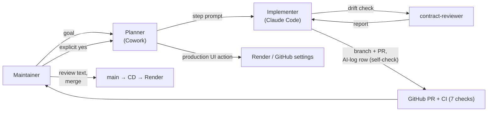

# Agent team and process

Who (human or agent) does what on BenchTrack, and how work moves between them. This puts in one place what [`ai-workflow.md`](ai-workflow.md) (the step-by-step log), [`../security/agent-security-notes.md`](../security/agent-security-notes.md) (access and approvals) and [`permissions.md`](permissions.md) (enforced limits) describe in detail.

## Members and responsibilities

| Member | Kind | Responsible for | May not |
|---|---|---|---|
| **Maintainer** | Human | Product decisions (answers spec questions, owns `product-spec.md` §9); reviews every PR and the evidence in it; runs and checks the app; accounts, secrets and Render settings; approves each production action; **merges to `main`** | — |
| **Planner / reviewer**: Claude in the Cowork desktop app | Agent | Plans the steps with the maintainer; reviews results; operates web UIs through Claude in Chrome (GitHub, Render) for read-only diagnosis, and for changes only after the maintainer's explicit "yes" | Merge (blocked by the platform classifier and by the ruleset); act on production without a "yes" |
| **Implementer**: Claude Code CLI in the repo | Agent | Implements one step at a time per [`AGENTS.md`](../AGENTS.md): contract first, tests with every change, one commit per task, branch + PR; runs all checks; writes the docs and the AI-log row with its own self-check | Read `.env`, push to `main`, force-push, merge, run destructive commands (guard hook and deny rules) |
| **Contract reviewer**: subagent `contract-reviewer` | Agent (read-only: Read, Grep, Glob) | Independent drift check between `openapi.yaml`, the backend and `frontend/src/api` before a PR; reports a table with `file:line` | Edit files or run commands |
| **Explore** (built-in subagent) | Agent (read-only) | Broad searches for the implementer when needed | Edit files |

Tools the agents use (not team members): the `contract-first-endpoint` and `release-check` skills (repeatable workflows), the read-only `benchtrack` MCP server (API data), and the guard and ruff hooks (guardrails). See [`agent-extension-pack.md`](agent-extension-pack.md).

## How they work together

1. **Plan → issue.** The maintainer and the planner turn a goal into an **issue** in the [task tracker](https://github.com/mrfmanuel/benchtrack/issues) with testable acceptance criteria ([template](../.github/ISSUE_TEMPLATE/task.md)). Since 2026-10-21 every change starts from an issue; earlier steps were planned in chat and are recorded only in the *Prompt* column of [`ai-workflow.md`](ai-workflow.md).
2. **Spec first.** If the step changes behaviour, the decision goes into `product-spec.md` §9 before any code. Spec conflicts are flagged, not silently resolved (AGENTS.md).
3. **Implement.** The implementer reads the issue and works on a branch named `<type>/<issue#>-<slug>`. For an API change it follows the contract-first order (`openapi.yaml` → backend tests → backend → frontend types/client → frontend tests), then runs all suites (`scripts/test_all.py`) and the linters.
4. **Independent check.** The `contract-reviewer` subagent reviews the result read-only; real findings are fixed or logged as follow-ups. `release-check` gates the PR.
5. **Hand-off.** The implementer opens a PR whose body says `Closes #<issue#>` and ticks each acceptance criterion with its evidence (commands and their outputs, test names, links), and appends the AI-log row. Its *Manual review* cell reads "Agent self-check (human review pending)" and lists what the agent found and fixed.
6. **Review and merge.** The maintainer reviews the PR (sometimes with the planner), replaces the *Manual review* cell with what they actually checked, and merges. The ruleset requires the PR and all 7 CI checks.
7. **Deploy and operate.** CD deploys and verifies the commit. Production actions (re-runs, settings, probes) happen only after an explicit "yes" in chat, and diagnosis stays read-only until then ([incident example](../ops/incidents/2026-10-21-deploy-not-applied.md)).

**Communication runs through the repository and the tracker**, not agent-to-agent messages: issues, the spec, `AGENTS.md`, the contract, PR descriptions and the AI log are the shared context. Every step leaves a reviewable trail.

## Rules that came from real events

| Event | Rule |
|---|---|
| The planner tried to merge PR #1; the platform classifier blocked "Merge Without Review" | Humans merge; enforced by the `protect-main` ruleset and a `gh pr merge` deny rule |
| Deploy didn't apply (CD skipped silently) | Diagnose read-only, act only after a "yes"; CD now reports **NOT DEPLOYED** |
| The approved rate-limit probe method was blocked by Cloudflare | Stop, explain and disclose a change of procedure before running it |
| `contract-reviewer` wasn't available in a fresh session without the plugin | Skills and subagents are synced into `.claude/` so every session has them |
| The self-review found no task tracker, so tasks had no acceptance criteria outside chat | Every change starts from an issue; PRs close it and tick its criteria with evidence |
