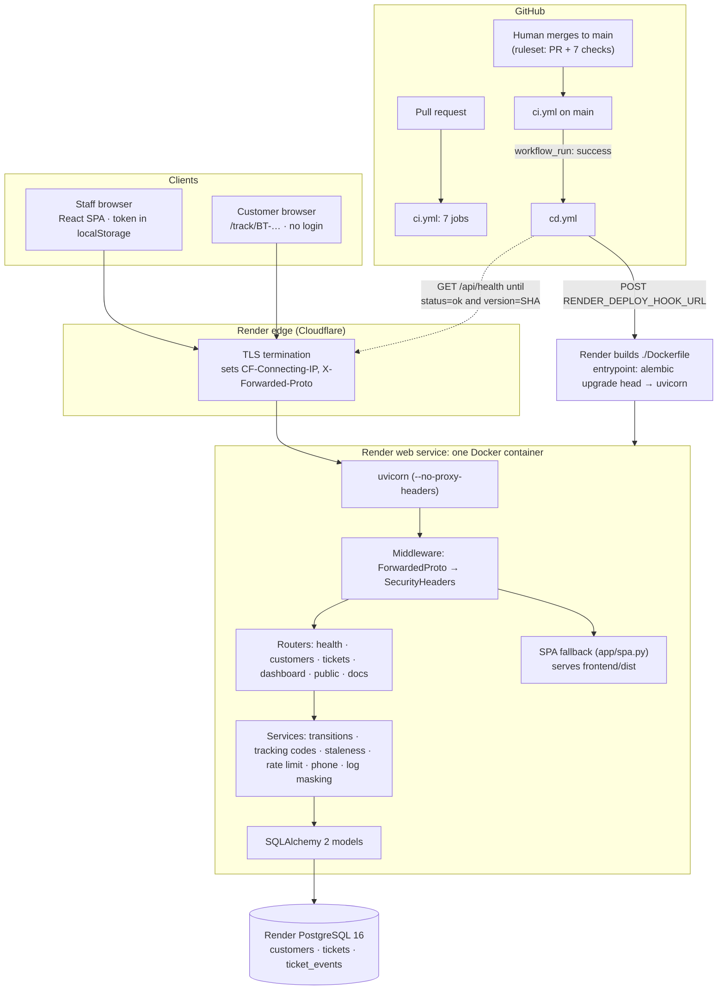
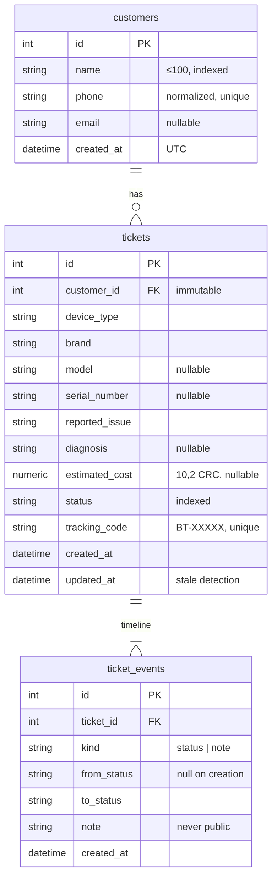
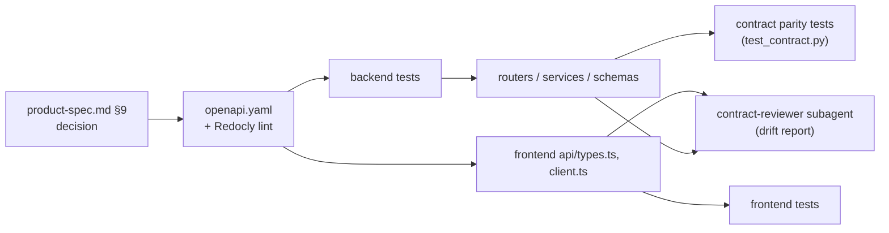
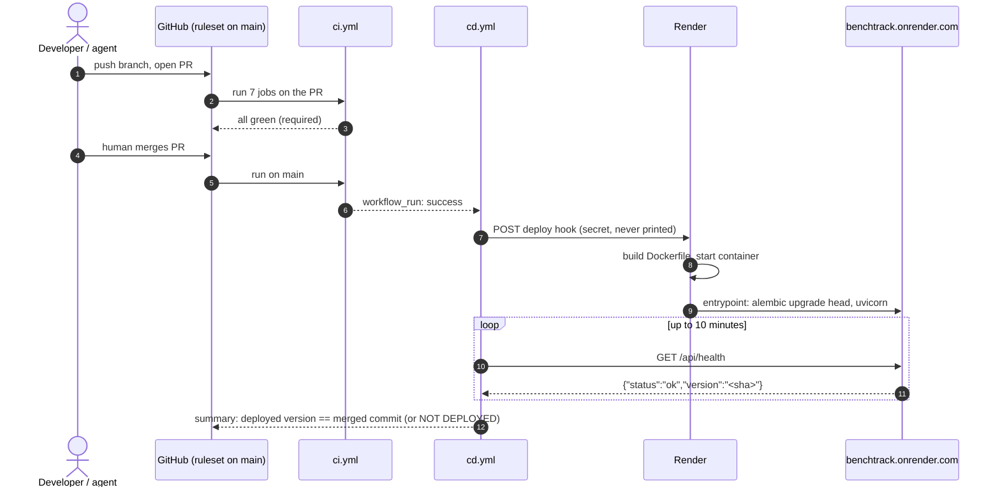

# Architecture

How BenchTrack's pieces fit together: frontend, backend, database, containers, CI/CD and Render. The product rules are in [`product-spec.md`](../product-spec.md) and the API in [`openapi.yaml`](../openapi.yaml); this page is about structure.

## 1. The whole system



Local development has the same shape: Docker Compose runs the same image next to a `postgres:16-alpine` container, both published on `127.0.0.1` only, without the edge in front.

## 2. Request paths

| Request | Handled by | Notes |
|---|---|---|
| `GET /`, `/dashboard`, `/tickets/42`, `/track/BT-DEM22` | SPA fallback | Any non-API `GET` that would 404 returns `index.html` with `Cache-Control: no-cache`; hashed `/assets/*` files are served from `frontend/dist`. Implemented in the 404 handler, not as a catch-all route, so API routing is unchanged. |
| `/api/customers`, `/api/tickets/*`, `/api/dashboard` | Staff routers | `require_staff` compares the bearer token with `STAFF_TOKEN` in constant time; missing or wrong → `401`. |
| `GET /api/public/track/{code}` | Public router | No auth. Rate-limited (10/min per client key) **before** lookup; responds with the `PublicTracking` whitelist model (`extra="forbid"`). |
| `GET /api/health` | Health router | `SELECT 1`; `200 ok` or `503 degraded`, always with `version`. Used by Docker, Render and CD. |
| `GET /docs`, `/api/openapi.yaml` | Docs router | Swagger UI rendered from the repository's `openapi.yaml`, not from FastAPI's generated schema. |
| Unknown `/api/*` | Error handler | JSON `404 not_found`; never the SPA. |

Every response passes through `SecurityHeadersMiddleware` (per-path CSP, `nosniff`, `X-Frame-Options: DENY`, `Referrer-Policy`, Permissions-Policy, HSTS over HTTPS, `Cache-Control: no-store` on the API). `ForwardedProtoMiddleware` restores only the `https` scheme from the edge; the client IP for the rate limit comes from `CLIENT_IP_HEADER` (`CF-Connecting-IP` on Render), never from `X-Forwarded-For`.

## 3. Backend (`backend/`)

```text
app/
├── main.py              app factory: settings, logging, middleware, routers, SPA
├── config.py            Settings (pydantic-settings): STAFF_TOKEN ≥ 16 chars, DATABASE_URL, …
├── routers/             thin HTTP layer, one module per contract tag; operation_id = contract operationId
├── services/            business rules: transitions, tracking codes, staleness, rate limit, phone, client IP
├── schemas.py           Pydantic models mirroring openapi.yaml components
├── models.py, db.py     SQLAlchemy models, UTC datetime type, naming conventions, session
├── errors.py            the single {"error": {code, message, details}} envelope
├── auth.py, deps.py     bearer auth, pagination params, path validation, public rate limit
├── security_headers.py  CSP and other headers
├── spa.py               SPA fallback
└── seed.py              idempotent fictional demo data (BT-DEM.. codes)
alembic/                 migrations (run on every container start)
tests/unit, tests/api, tests/integration
```

Rules the code follows: routers never contain business logic; every error goes through `errors.py`; the public route only ever builds the whitelist model; tracking codes are masked in logs (`BT-*****`).

## 4. Frontend (`frontend/`)

```text
src/
├── api/client.ts, types.ts   the only module that calls fetch; one function per operationId; types from the contract
├── lib/                      token store, error messages, status labels and transitions, formatting
├── layouts/StaffLayout.tsx   guards staff routes (no token → /sign-in)
├── pages/                    Dashboard, Tickets, TicketDetail, NewTicket, Customers, CustomerDetail, Receipt, Track, SignIn
└── components/               forms, tables, timeline, status-change control
```

- The staff token lives in `localStorage` under `benchtrack.staffToken` (spec §5). Any `401` clears it and returns to sign-in with "Invalid or expired token".
- Public pages (`/track`, `/track/:code`) never send the token.
- In development Vite proxies `/api` and `/docs` to the backend. In production the same origin serves both, so there is no CORS.

## 5. Data model



Every status change and note writes a `ticket_events` row and bumps `tickets.updated_at`. There are no deletes in v1. Environments (SQLite for unit/API tests and quick local dev, PostgreSQL for integration tests, Compose and production) and migrations: [`database.md`](database.md).

## 6. Contract-first flow



CI fails if the contract doesn't lint or if an operation, operationId or success status differs between the app and the file. The `contract-first-endpoint` skill walks an agent through these steps ([agent extension pack](agent-extension-pack.md)).

## 7. Containers

- **`Dockerfile`, three stages:**
  1. `node:24-slim` runs `npm ci` and builds the SPA, with `VITE_SHOP_NAME` as a build argument.
  2. `python:3.12-slim` with uv runs `uv sync --locked --no-dev`.
  3. The runtime stage copies the virtualenv, `backend/`, `frontend/dist` and `openapi.yaml` into `/app`. The build fails if the contract or `index.html` is missing.
- **Runtime hardening:** the container runs as a non-root user (uid 10001), and setuid/setgid bits are stripped. `APP_VERSION` is declared last, so a new commit SHA rebuilds only that layer.
- **`docker/entrypoint.sh`:** runs `alembic upgrade head`, then `exec uvicorn … --no-proxy-headers` on `$PORT`.
- **Health check:** `docker/healthcheck.py` (stdlib `http.client`) calls `/api/health`; Docker, Compose and Render all use it.
- **`docker-compose.yml`:** a `db` service (PostgreSQL 16, `pgdata` volume, `127.0.0.1:5433`) and an `app` service that waits for `db` to be healthy, sets `DATABASE_URL` to `db`, uses JSON logs and `no-new-privileges`, and publishes on `127.0.0.1:${APP_PORT:-8000}`.

## 8. CI/CD and Render



- **CI jobs:** contract (Redocly); backend (ruff check and format, unit + API tests); integration (PostgreSQL service, fails on any skipped test); frontend (oxlint, Vitest, build); docker (builds the image, runs it against PostgreSQL, smoke-tests health, version, the SPA, the JSON 404, the security headers and the `X-Forwarded-For` regression); Semgrep; agent pack. Actions are pinned to SHAs, with `permissions: contents: read`.
- **CD:** runs only for a successful CI `push` run on `main`, in a single-concurrency `deploy-production` group. Render Auto-Deploy is **off**, so only CD deploys.
- **Render configuration:**
  - Docker runtime, health check path `/api/health`.
  - `DATABASE_URL` is the Internal Database URL of the Render PostgreSQL.
  - `CLIENT_IP_HEADER=CF-Connecting-IP`, `LOG_FORMAT=json`.
  - `STAFF_TOKEN` is production-only.
  - Details: [`deployment.md`](deployment.md).
- **Rollback:** redeploy the previous good commit from Render's deploy history. Migrations must stay backward compatible for one release ([runbook §4](../ops/runbook.md#4-deploy-and-rollback)).

## 9. Where AI agents fit

The agents don't run in production. Claude Code works in the repository under [`.claude/settings.json`](../.claude/settings.json): permission rules, a guard hook and a ruff hook. The read-only [`benchtrack` MCP server](../mcp-server/README.md) reads the API through the same staff endpoints. Humans merge and approve production actions ([permissions](permissions.md)).
